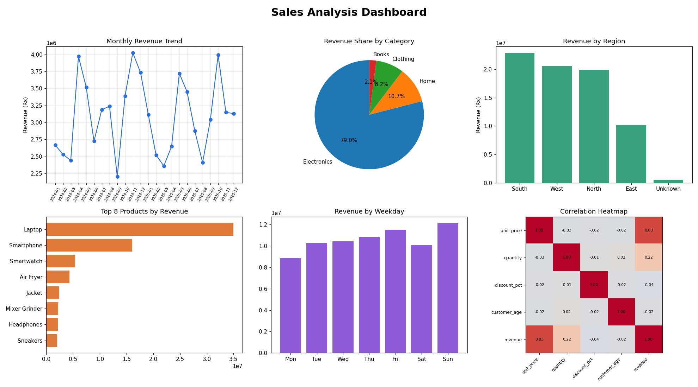

# Python Projects Portfolio

Two beginner-to-intermediate Python projects covering **data analysis** and **database-driven applications**.

| Project | What it does | Tech |
|---|---|---|
| [Sales Data Analysis Dashboard](data_dashboard/) | Cleans a sales dataset, finds business insights and draws charts | Python, Pandas, NumPy, Matplotlib |
| [Expense Tracker](expense_tracker_mysql/) | Add, edit, delete and categorize expenses with monthly summaries | Python, MySQL, OOP, Tkinter |

---

## 1. Sales Data Analysis Dashboard

Analyses 5,000 sales orders (region, category, product, price, discount, customer age).

**Features**
- Data cleaning: removes duplicates, fills missing values, converts dates
- Feature engineering: revenue, month, weekday, age group
- Insights: best category, region, month and weekday, average order value, monthly growth
- Six charts plus a combined dashboard image: monthly trend, category share, region revenue, top products, weekday revenue, correlation heatmap



**Run it**
```bash
cd data_dashboard
pip install -r requirements.txt
python dashboard.py
```
Or open `Sales_Dashboard.ipynb` in Jupyter Notebook and run all cells.

> The included `sales_data.csv` is synthetic sample data created by `generate_data.py`. You can replace it with any real dataset that has similar columns.

---

## 2. Expense Tracker (Python + MySQL)

A CRUD application that stores expenses in a MySQL database.

**Features**
- Add, view, edit and delete expenses
- 8 categories with input validation (date format, positive amount)
- Monthly summary with category-wise totals and percentages
- Export all data to CSV
- Command-line menu, Tkinter GUI, and Jupyter notebook versions
- Parameterised SQL queries (protects against SQL injection)

**Run it**
1. Install and start MySQL Server
2. `pip install mysql-connector-python`
3. Put your MySQL password in `expense_tracker_mysql/config.py` (or set the `DB_PASSWORD` environment variable)
4. Run:
```bash
cd expense_tracker_mysql
python main.py      # command-line version
python gui.py       # Tkinter GUI
```
The database and table are created automatically on first run. Or open `Expense_Tracker_MySQL.ipynb` in Jupyter.

---

## Concepts Practised
- Object-oriented programming (classes and methods)
- SQL: CREATE, INSERT, UPDATE, DELETE, GROUP BY, aggregate functions
- Python-MySQL connectivity and exception handling
- Pandas: groupby, cleaning, datetime handling, `pd.cut`
- NumPy: statistics and random data generation
- Matplotlib: line, bar, pie, horizontal bar and heatmap charts
- Building a desktop GUI with Tkinter

## Author
**Venkatesh Gajul** - [LinkedIn](www.linkedin.com/in/venkateshgajul) | [Email](mailto:venkateshgajul783@gmail.com)
